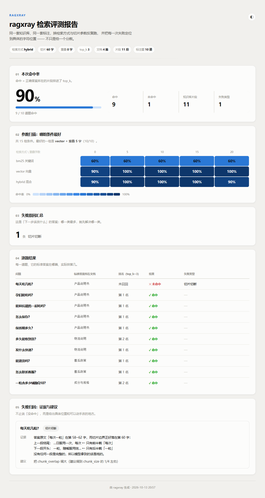

# ragxray

**RAG 检索失败归因工具** —— 不只告诉你「命中率 60%」，还告诉你**是哪道题、为什么没命中、该改哪个参数**。

大多数检索评测跑完只给你一个分数。分数低了你还是不知道该动什么，只能一个个参数试。ragxray 针对每一道失败的题给出**归因类型 + 可核对的证据 + 能直接照做的建议**，并把不同参数组合的结果摆在一起，让你看出「换哪个旋钮有用、哪个没用」。



报告是一个自包含的 HTML 文件（不联网、不依赖前端框架），内置浅色 / 深色两套配色，右上角可切换，直接 `Ctrl+P` 也能导成 PDF。

## 它多做了什么事

| | 常见评测脚本 | ragxray |
|---|---|---|
| 输出 | 一个分数 | 分数 + 每道失败题的归因 |
| 「没命中」 | 到此为止 | 定位到**具体第几个字**被切断 / 哪个词对不上 |
| 调参 | 逐个试 | 一次跑完整张「检索方式 × 切片重叠」网格 |
| 结论 | 「调大一点好像好一些」 | 「bm25 换什么参数都是 60%，因为它的失败是同义词问题，不是切片问题」 |

最后那句就是这个工具的用处：**它区分得开「调参能救的失败」和「调参救不了的失败」**。

## 真实输出

同一份知识库（4 篇文档 → 11 个片段）、10 道带标注的问题，只换检索方式和切片重叠：

```
  检索方式      重叠 0    重叠 5   重叠 10   重叠 15   重叠 20
  ------------------------------------------------------------------
  bm25         6/10      6/10     6/10     6/10     6/10
  vector       9/10     10/10    10/10    10/10    10/10
  hybrid       9/10     10/10    10/10    10/10     9/10

  bm25    重叠 0   60%   同义词失配×3，切片切断×1
  bm25    重叠 20  60%   同义词失配×4        ← 重叠怎么调都救不了
  vector  重叠 0   90%   切片切断×1
  vector  重叠 5   ✅ 全部命中
  hybrid  重叠 20  90%   同义词失配×1        ← 重叠过头，反而掉回来了
```

三个结论，都能直接对应到动作：

1. **`chunk_overlap` 从 0 调到 5，就修好了「切片切断」** —— 这是调参能解决的。
2. **`bm25` 那一行，重叠从 0 到 20 全是 60%** —— 它的失败是对不上词，跟切片无关。这时候该换检索方式，不是继续调参数。
3. **`hybrid` 在重叠 20 时从 100% 掉回 90%** —— 重叠不是越大越好，切太碎会把噪声一起带进来。

失败时看到的是这样的（不是一句"效果不好"）：

```
❌  每天吃几粒？               未召回
     ├ 失败类型  切片切断
     ├ 证据      答案原文「每次一粒」在第 58~62 字，而切片边界正好落在第 60 字：
     │           上一段结尾： …日服用一次，每次   ← 只有前半截「每次」
     │           下一段开头： 一粒，随餐服用效…   ← 只有后半截「一粒」
     │           没有任何一段是完整的，所以模型拿到的话是残的。
     └ 建议      把 chunk_overlap 调大（建议调到 chunk_size 的 1/4 左右）
```

## 四类归因是怎么判的

每条规则都只依赖**你已经标注好的东西**（问题、答案在哪篇文档、答案原文短语），不需要额外标注，也不需要调模型：

| 归因类型 | 触发条件 | 含义 |
|---|---|---|
| **切片切断** | 没有任何片段完整包含答案短语，但答案短语在原文里找得到，且有切片边界落在它内部 | 切片把答案劈开了，调 `chunk_overlap` |
| **同义词失配** | 含答案的片段被召回了，但它和问题的分词**零重合** | 字面对不上，换 `vector` / `hybrid` |
| **排序过低** | 含答案的片段被召回了，词也对得上，但排在 `top_k` 之外 | 调大 `top_k`，或加一层精排 |
| **标注可疑** | 标注里写的答案原文，在文档里根本找不到 | 先别急着改代码，检查标注 |

判定用的都是可复核的事实（字符下标、分词交集），不是模型打分，所以你能自己打开文档数一遍确认它对不对。

## 快速开始

```bash
git clone https://github.com/songningtao-star/rag-xray.git
cd rag-xray
pip install -r requirements.txt

python run.py                                  # 跑一次评测
python run.py --sweep                          # 额外跑参数扫描
python run.py --sweep --html report.html       # 额外生成 HTML 报告
```

第一次跑会下载中文向量模型 `BAAI/bge-small-zh-v1.5`（约 90MB，走 HuggingFace）。
国内网络如果卡住，先设镜像再跑：

```bash
export HF_ENDPOINT=https://hf-mirror.com     # Windows: set HF_ENDPOINT=https://hf-mirror.com
```

装成命令用也可以：

```bash
pip install -e .
ragxray --sweep --html report.html
```

跑测试（不需要联网，不加载向量模型）：

```bash
python -m pytest -q
```

## 换成你自己的数据

只要两样东西，都不需要改代码：

**1. 知识库** —— `data/docs/` 下放 `.txt` / `.md`，一个文件一篇文档，文件名就是文档 ID。

**2. 标注集** —— `data/queries.jsonl`，一行一条：

```json
{"query": "每天吃几粒？", "doc": "产品说明书", "answer": "每次一粒"}
```

`answer` 必须是**文档里一字不差的原文短语**。切片切断和标注可疑这两类归因全靠它定位，所以它值得你花几分钟准确地摘。

**3. 实验条件** —— `config.yaml`：

```yaml
docs_dir: data/docs
queries: data/queries.jsonl
chunk_size: 60      # 每段多少字
chunk_overlap: 0    # 相邻两段重叠多少字
retriever: hybrid   # bm25 / vector / hybrid
top_k: 3
```

## 项目结构

```
ragxray/
  loaders.py      读文档和标注集
  chunkers.py     切片（固定长度 + 重叠）
  retrievers.py   三种检索：bm25 / vector / hybrid(RRF)，接口一致可互换
  metrics.py      命中判定：正确片段有没有排进 top_k
  attributor.py   ★ 归因引擎，本项目的核心
  runner.py       串起主流程 + 终端报告
  sweep.py        参数扫描（检索方式 × 重叠字数）
  report.py       生成自包含的 HTML 报告
  cli.py          命令行入口

demos/            从零推导的过程记录（step1 检索→评测，step4 切片），
                  每个脚本都能单独跑，看得到中间每一步的输出
data/             示例数据（公开的产品说明书式文本，非真实业务数据）
docs/             报告截图
tests/            归因规则的单元测试
```

`demos/` 那四个脚本是刻意留下的：它们记录了「为什么是这四类归因」的推导过程——先复现假命中，再发现向量检索救回同义词，再看到切片边界劈开答案。想知道设计怎么来的，按顺序跑一遍比看结论有用。

## 已知限制

诚实列一下，免得你踩坑：

- **语料规模小。** 示例只有 4 篇文档 11 个片段，是为了让每条归因都能手工核对。规则本身不依赖语料大小，但结论的统计意义有限。
- **只评「正确文档/片段有没有被召回」，不评最终回答质量。** 生成阶段的幻觉、答非所问不在范围内。
- **归因规则是启发式的，不是模型判断。** 比如「分词零重合」在中文极短的 query 上可能误判。证据是给你核对的，不是给你盲信的。
- **Cross-Encoder 精排还没接。** `attributor` 给出的建议里提到它，但 `retrievers.py` 目前只有 bm25 / vector / hybrid 三种。模型下载链路在国内不稳，留作下一步。

## Roadmap

- [ ] 接入 Cross-Encoder 精排（`fastembed` 的 `TextCrossEncoder`），对比加精排前后「排序过低」的占比变化
- [ ] 从 `core` 检索结果反推每条规则的可信度，给出归因置信度
- [ ] 支持多答案 / 多文档标注
- [ ] 输出 CI 可用的退出码，让「命中率跌破阈值」能卡住流水线

## License

MIT
